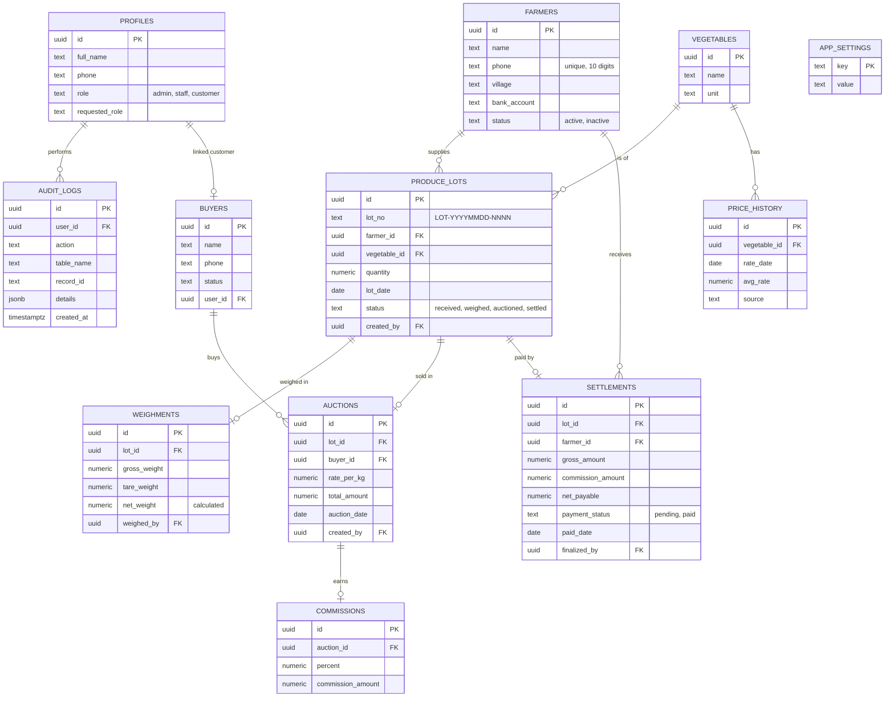

# ER Diagram

Tables used by the application. Columns listed are the ones the code reads or writes.
Check against the Supabase Table Editor before submitting, the database can have extra columns.

## Lot status flow

`received` -> (weighment) -> `weighed` -> (auction + commission) -> `auctioned` -> (admin finalizes settlement) -> `settled`
